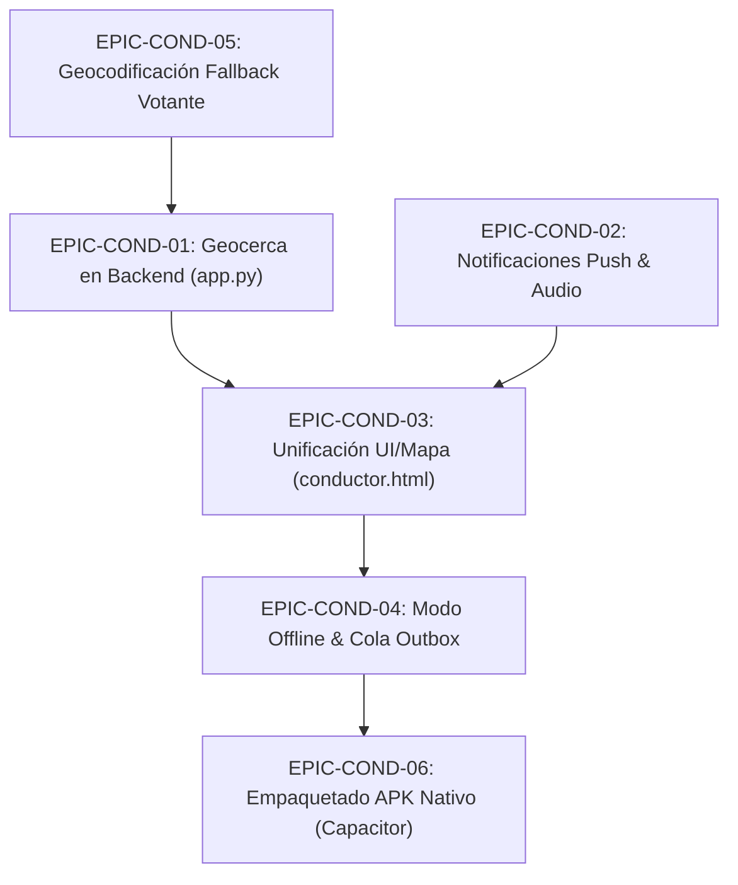

# 📱 ROADMAP & ESPECIFICACIÓN: Conversión a App Móvil (Módulo Conductor Día D)

> **Documento de especificación para agentes IA (`logistica` / Esme, `desarrollador` / Zev, `auditoria` / Milo)**.  
> **Fecha de actualización:** 2026-10-16  
> **Contexto del Grafo:** `graphify-out/graph.json`  
> **Objetivo:** Convertir el ecosistema web actual —en especial la operativa del conductor (`static/conductor.html` y endpoints de transporte)— en una aplicación móvil robusta (PWA + APK nativo) con rastreo GPS continuo en segundo plano, geocercas automáticas y tolerancia a cortes de red en la jornada electoral.

---

## 🧭 Diagnóstico de Brechas Arquitectónicas

1. **Rastreo en Segundo Plano (Fondo / Background):**  
   - *Problema:* En la web/PWA actual (`navigator.geolocation.watchPosition`), cuando el chofer abre Waze o Google Maps para navegar, o cuando la pantalla se bloquea, el navegador suspende la ejecución. El centro de monitoreo (`static/transporte.html`) deja de recibir coordenadas GPS.
   - *Solución:* Requerir Foreground Service en Android con notificación persistente para APK (`@capacitor-community/background-geolocation`) y WakeLock API para PWA.

2. **Doble Sistema en `conductor.html`:**  
   - *Problema:* Coexisten la UI vieja de un solo tramo (`state.viajeActual` en `rutas`) y el sistema nuevo de 3 tramos (`#misTramosNuevos` y `#vueltasDisponiblesBox` en `viajes`). El mapa no traza la geometría OSRM de los tramos nuevos y recurre a consultas lentas a Nominatim.
   - *Solución:* Unificar la vista en un flujo único guiado: Búsqueda → Ida al Colegio → Vuelta al Hogar / Retorno al Pool.

3. **Geocercas de Llegada Inexistentes:**  
   - *Problema:* El chofer debe interactuar manualmente con el botón "Llegué" en cada parada mientras conduce.
   - *Solución:* El endpoint `POST /api/conductor/ubicacion` debe evaluar la distancia Haversine contra el destino activo y autocompletar el tramo al ingresar al radio de 40-50m.

4. **Alertas y Notificaciones Push:**  
   - *Problema:* Web Push usa claves genéricas y `armar_viaje_redondo` / `optimizar_asignaciones` no invocan `enviar_push`. Falta sonido audible persistente para avisar al chofer.
   - *Solución:* Conectar `enviar_push` con audio local loop y preparación para FCM (Firebase Cloud Messaging).

---

## 📋 Épicas y Tareas Técnicas Pendientes

### Mejoras de seguridad y despacho (actualizado 2026-10-16)
- ✅ `static/conductor.html` + `app.py: transporte_reportar_incidencia()` — botones de elector ausente/rechazo solo en tramo de búsqueda; la incidencia se registra con conductor, tramo, hora y GPS disponible, y el tramo queda cerrado para liberar al chofer.
- ✅ `app.py: completar_tramo()` — exige cédula conductora y vehículo dueño del tramo; tanto conductor como central envían identidad y completar un tramo ajeno o sin asignación se rechaza.
- ✅ `app.py: conductores_cercanos()` + `static/conductor.html` — panel radio 2/5/10 km, ordenado por distancia, limitado a unidades disponibles con GPS reciente (10 min) y sesión de usuario con rol conductor/logística; no estima coordenadas faltantes.
- ✅ `app.py: conductor_sos()` + `static/conductor.html` — SOS registra evento y solicita push; la UI diferencia push enviado de alerta guardada para consulta central.
- ✅ `static/auth.js: initRolSwitcher()` — oculta selector de roles solamente en `conductor.html` durante la operación.
- 🟡 **`static/conductor.html` + central logística** — crear vista central para consultar/moderar incidencias de traslado y reconocer SOS; hoy SOS/incidencias quedan registrados, pero no hay bandeja de despacho con acuse de recibo ni asignación automática de reemplazo.
- 🟡 **`static/conductor.html` mapa** — la capa actual de Leaflet permanece sin teselas/calles y el mapa de calor territorial de votantes no se implementó; el panel incorporado lista unidades cercanas a partir de GPS reciente, no votantes sin coordenadas ni direcciones geocodificadas.
- ✅ **Seguimiento coordinado conductor-votante (`static/mi_recogida.html`, `app.py`, `database.py`)** — el votante puede activar GPS por intervalos de 5 minutos (hasta 12 horas) mientras mantiene el enlace y el teléfono activo; backend compara puntos recientes ligados a traslado activo, señala posiciones cercanas (<500 m) y muestra atención si el conductor pierde GPS >2 min mientras el votante sigue enviando latidos (<10 min). Esto verifica proximidad observada, no identidad física ni recorrido exacto.
- ✅ **Compartir ubicación y destino sin trayecto (`static/mi_recogida.html`, `static/ubicacion_votante_compartida.html`)** — enlace de solo lectura comparte dos puntos; página receptora refresca la ubicación más reciente y el destino automáticamente cada 20 s para reflejar reportes del votante cada 5 min; no dibuja polilínea/ruta.
- 🟡 **Seguimiento conductor-votante** — la advertencia aparece al votante en su enlace al actualizar cada 20 s; falta una alerta push/bandeja central en tiempo real y registrar explícitamente estado “viaje interrumpido” en el flujo del dirigente.

---

### EPIC-COND-01: Geocerca Automática y Auto-Checkin en Backend
* **Archivo foco:** `app.py` (`conductor_ubicacion`, líneas ~6886–6910)
* **Responsable:** `desarrollador` (Zev)
* **Requisitos:**
  1. En cada recepción de GPS (`lat`, `lng`, `cedula`):
     - Obtener el `transporte_id` y consultar si tiene un tramo con `estado = 'en_curso'` en la tabla `viajes`.
     - Si existe, calcular la distancia Haversine entre `(lat, lng)` y `(destino_lat, destino_lng)`.
     - Si `distancia <= 0.050` (50 metros):
       - Ejecutar la lógica de `completar_tramo(viaje_id)` automáticamente.
       - Si el tramo completado era `busqueda`, cambiar el tramo subsiguiente (`ida`) a `en_curso`.
       - Si el tramo era `ida`, marcar como completado y generar el tramo `vuelta` en el pool general (`transporte_id IS NULL`).
       - Registrar en la auditoría interna el auto-completado por geocerca.
     - Retornar en la respuesta JSON: `{"success": true, "geocerca_disparada": true, "tramo_completado_id": viaje_id}`.

---

### EPIC-COND-02: Notificaciones Push Reales y Despertador de Pantalla
* **Archivos foco:** `app.py` (`armar_viaje_redondo`, `optimizar_asignaciones`, `tomar_tramo`), `static/conductor-sw.js`, `static/conductor.html`
* **Responsable:** `logistica` (Esme) / `desarrollador` (Zev)
* **Requisitos:**
  1. En `app.py`:
     - Invocar `enviar_push(ced_cond, "Nuevo traslado asignado", f"Votante: {votante_nombre}")` dentro de:
       - `armar_viaje_redondo()`
       - `optimizar_asignaciones()` (a cada conductor que reciba una asignación)
  2. En `conductor.html` y `conductor-sw.js`:
     - Incorporar un archivo de audio local (`static/vendor/alert-beep.mp3` o tono sintético en loop).
     - Al recibir push o detectar un cambio de `_ultimoViajeId`:
       - Disparar vibración de alta duración: `navigator.vibrate([500, 250, 500, 250, 500])`.
       - Reproducir el tono de alerta hasta que el conductor presione "Aceptar viaje" o toque la pantalla.
     - Actualizar `static/conductor-sw.js` para cachear los vendors locales en lugar de URLs de CDNs externas (`https://cdn.tailwindcss.com`).

---

### EPIC-COND-03: Unificación de UI y Trazado de Geometría en el Mapa
* **Archivos foco:** `static/conductor.html`
* **Responsable:** `desarrollador` (Zev)
* **Requisitos:**
  1. Desprender la dependencia del sistema legacy de `rutas` en `conductor.html`:
     - El componente principal debe ser la tarjeta de etapas del sistema nuevo (`viajes`):
       - Fase 1: `busqueda` (Naranja - "Ir a recoger a [Nombre]")
       - Fase 2: `ida` (Verde - "Llevar al colegio [Local]")
       - Fase 3: `vuelta` (Celeste - "Retorno a su casa" o Pool)
  2. En el mapa Leaflet (`actualizarMapa`):
     - Eliminar las llamadas a Nominatim OSM para geocodificar origen y destino del viaje (son lentas y fallan sin red).
     - Usar directamente los campos ya calculados: `origen_lat`, `origen_lng`, `destino_lat`, `destino_lng`.
     - Si el tramo tiene `geometria` (JSON con lista de coordenadas de calles provisto por OSRM), trazar el `L.polyline` con el color correspondiente (`#f97316` para búsqueda, `#22c55e` para ida, `#38bdf8` para vuelta).
     - Ajustar la vista con `map.fitBounds(poly.getBounds().pad(0.2))`.

---

### EPIC-COND-04: Modo Offline, Cola Outbox y Pantalla Siempre Activa (WakeLock)
* **Archivos foco:** `static/conductor.html`, `static/conductor-sw.js`
* **Responsable:** `desarrollador` (Zev)
* **Requisitos:**
  1. **Screen WakeLock:**
     - Activar `navigator.wakeLock.request('screen')` cuando el chofer esté en estado `disponible` o tenga un tramo `en_curso`, evitando que la pantalla se apague mientras el celular está en el soporte del vehículo.
     - Manejar el evento `visibilitychange` para re-solicitar el WakeLock al volver a primer plano.
  2. **Cola Outbox Offline (IndexedDB / LocalStorage):**
     - Si `POST /api/conductor/ubicacion` o `POST /api/transporte/completar_tramo` fallan por falta de conectividad (offline), almacenar la carga útil en `localStorage.getItem('outbox_conductor')`.
     - Monitorear el evento `window.addEventListener('online')` y reintentar vaciar la cola en orden cronológico enviando los pings pendientes acumulados.
  3. **Links Nativos de Navegación:**
     - Botón Waze: `waze://?ll=${lat},${lng}&navigate=yes` con fallback a web `https://waze.com/ul?ll=...`.
     - Botón Google Maps: `google.navigation:q=${lat},${lng}` con fallback a web `https://www.google.com/maps/dir/...`.

---

### EPIC-COND-05: Geocodificación de Respaldo para Votantes
* **Archivos foco:** `app.py` (`_resolver_casa_votante`, líneas ~7406–7419)
* **Responsable:** `logistica` (Esme)
* **Requisitos:**
  1. Si `posible_votos.votante_lat/lng` es `NULL` (el votante no abrió su link público):
     - Buscar en `solicitudes_recogida.ubicacion` (texto descriptivo) o `padron2026_completo.direccion` + distrito.
     - Si existe dirección textual, consultar Nominatim o una tabla caché local de barrios/distritos para estimar coordenadas representativas.
     - Si no se encuentra coordenada exacta, asignar por defecto las coordenadas aproximadas del barrio/local de votación para permitir armar la ruta sin bloquear la logística con un error fatal.

---

### EPIC-COND-06: Empaquetado APK Nativo Android con Capacitor
* **Archivos foco:** `mobile-apk/`, `static/descargas.html`
* **Responsable:** `desarrollador` (Zev) / `auditoria` (Milo)
* **Requisitos:**
  1. Configurar proyecto Capacitor en subdirectorio `mobile-conductor/` apuntando a `static/conductor.html`.
  2. Integrar plugins nativos:
     - `@capacitor-community/background-geolocation`: Permite emitir pings GPS hacia `/api/conductor/ubicacion` en segundo plano cada 8 segundos mediante un servicio en primer plano de Android con notificación.
     - `@capacitor/push-notifications`: Recepción nativa de notificaciones push de alta prioridad.
     - `@capacitor/keep-awake`: Soporte nativo para mantener pantalla encendida.
  3. Compilar APK Release firmado: `ddia-conductor.apk`.
  4. Agregar tarjeta de descarga en `static/descargas.html`:
     - Título: *"App Conductor (Logística y Flota)"*
     - Descripción: *"App para choferes con GPS en segundo plano, alertas de viaje y navegación directa."*
     - Enlace de descarga directa a `/api/descargar/apk/conductor`.

---

## 🔍 Matriz de Pruebas y Validación (Checklist)

- [ ] **Test 1:** Chofer cambia a Waze y regresa tras 3 minutos; el servidor recibió pings GPS ininterrumpidos.
- [ ] **Test 2:** Chofer se aproxima a < 40m de la casa del votante; el tramo `busqueda` se completa solo y pasa a `ida`.
- [ ] **Test 3:** Se corta la conexión de datos; el chofer presiona "Llegué"; al volver la señal, la acción se sincroniza sin pérdida de datos.
- [ ] **Test 4:** Votante sin GPS explícito; el sistema arma el viaje redondo usando la dirección aproximada sin fallar.
- [ ] **Test 5:** Descarga e instalación limpia de `ddia-conductor.apk` en un dispositivo Android de prueba.
