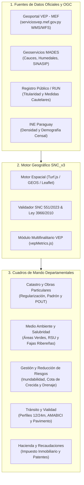

# ESPECIFICACIÓN TÉCNICA: CATASTRO MULTIFINALITARIO MUNICIPAL BASADO EN EL MODELO CIUDADES SUSTENTABLES VEP (MEF)
## SISTEMA NACIONAL DE CATASTRO (SNC_v3) — VINCULACIÓN INTERDEPARTAMENTAL MUNICIPAL

---

## 1. Fundamento Técnico e Institucional

El proyecto **Ciudades Sustentables VEP** ([https://ciudadessustentablesvep.mef.gov.py/](https://ciudadessustentablesvep.mef.gov.py/)), administrado por el Ministerio de Economía y Finanzas (MEF), constituye el estándar metodológico oficial de la República del Paraguay para transformar los catastros físicos y fiscales en **Catastros Multifinalitarios**.

En la arquitectura de **SNC_v3**, este modelo permite que los polígonos parcelarios, vías y equipamientos no sirvan únicamente para la validación geométrica de expedientes individuales (Resolución SNC 551/2023), sino que alimenten directamente los **sistemas de toma de decisiones y cuadros de mando (dashboards)** de cada dirección municipal bajo la **Ley Orgánica Municipal N° 3966/2010**.

---

## 2. Arquitectura de Interoperabilidad y Flujo de Datos



---

## 3. Matriz de Indicadores Técnicos por Dirección Municipal

### 3.1. Dirección de Catastro y Obras Particulares (DCOP)
*Marco Legal: Ley 3966/2010 (Arts. 224-239), Res. SNC 551/2023, Ley 7424/2025.*

| Código Indicador | Nombre del Indicador | Fórmula Matemática / Algoritmo Espacial | Unidad | Umbral / Meta VEP |
| :--- | :--- | :--- | :---: | :---: |
| **IND-CAT-01** | **Tasa de Titularidad Formal** | $\frac{\sum \text{Superficie Parcelas con Título Inscripto (DGRP)}}{\sum \text{Superficie Total Catastrada}} \times 100$ | $\%$ | $\ge 85\%$ |
| **IND-CAT-02** | **Superficie No Censada / Asentamientos de Hecho** | $\text{Área Total Urbana} - \sum \text{Área Parcelas Empadronadas}$ | $\text{Ha}$ | Tendencia a 0 (Ley 622/60) |
| **IND-CAT-03** | **Cumplimiento de Cesión Vial Obligatoria** | $\frac{\text{Área Cedida para Calles en Loteamiento}}{\text{Área Bruta de la Parcela Matriz}} \times 100$ | $\%$ | $\ge 16.0\%$ (Art. 235 Ley 3966) |
| **IND-CAT-04** | **Cumplimiento de Cesión de Espacios Verdes** | $\frac{\text{Área Plazas y Edificios Públicos}}{\text{Área Bruta de la Parcela Matriz}} \times 100$ | $\%$ | $5.0\% \le X \le 7.0\%$ (Art. 235) |
| **IND-CAT-05** | **Densidad Bruta Habitacional** | $\frac{\text{Población Estimada}}{\text{Superficie Zona Urbana (Ha)}}$ | $\text{hab/Ha}$ | POUT Municipal |

---

### 3.2. Dirección de Medio Ambiente y Salubridad (DMAS)
*Marco Legal: Ley 3239/2007 (Recursos Hídricos), Ley 4241/2010 (Bosques Protectores), Ley 3956/2009 (RSU).*

| Código Indicador | Nombre del Indicador | Fórmula Matemática / Algoritmo Espacial | Unidad | Umbral / Meta VEP |
| :--- | :--- | :--- | :---: | :---: |
| **IND-AMB-01** | **Espacio Verde Público por Habitante** | $\frac{\sum \text{Área de Plazas, Parques y Reservas Municipales}}{\text{Población Urbana Total}}$ | $\text{m}^2/\text{hab}$ | $\ge 9.0\text{ m}^2/\text{hab}$ (Recomendación OMS / VEP) |
| **IND-AMB-02** | **Preservación de Fajas Protectoras de Cauces** | $\frac{\text{Área Boscosa en Faja Ribereña (30m)}}{\text{Área Total de Servidumbre Hídrica}} \times 100$ | $\%$ | $100\%$ (Ley 4241/10 Art. 2) |
| **IND-AMB-03** | **Cobertura de Recolección de RSU** | $\frac{\text{N.° Parcelas Urbanas con Servicio Regular de RSU}}{\text{Total Parcelas Urbanas}} \times 100$ | $\%$ | $\ge 90\%$ (Ley 3956/09) |
| **IND-AMB-04** | **Afectación por Radio de Amortiguamiento de Vertedero** | $\text{Intersección Espacial}(\text{Parcelas}, \text{Buffer}(1000\text{ m, Vertedero}))$ | Parcelas | $0$ loteamientos residenciales admitidos |

---

### 3.3. Dirección de Gestión y Reducción de Riesgos de Desastres (DGRRD)
*Marco Legal: Ley 3966/2010 (Art. 238), Política Nacional de Gestión y Reducción de Riesgos.*

| Código Indicador | Nombre del Indicador | Fórmula Matemática / Algoritmo Espacial | Unidad | Umbral / Meta VEP |
| :--- | :--- | :--- | :---: | :---: |
| **IND-RSG-01** | **Exposición a Inundabilidad Periódica** | $\text{Intersección Espacial}(\text{Parcelas}, \text{Cota Crecida Máxima 50 años})$ | Parcelas / Ha | Prohibición de edificación / $0$ loteamientos |
| **IND-RSG-02** | **Vulnerabilidad de Drenaje Pluvial Urbano** | $\frac{\text{Área con Pendiente } < 0.5\% \text{ sin Red Pluvial}}{\text{Área Urbana Total}} \times 100$ | $\%$ | $\le 10\%$ |
| **IND-RSG-03** | **Exposición a Fuentes de Riesgo Tecnológico e Incendios** | $\text{Intersección Espacial}(\text{Parcelas}, \text{Buffer}(200\text{ m, Subestación / Depósitos Inflamables}))$ | Parcelas | Restricción de uso |

---

### 3.4. Dirección de Tránsito, Transporte y Vialidad (DTTV)
*Marco Legal: Ley 3966/2010 (Art. 236), Manual de Carreteras MOPC, Red de Movilidad AMABICI.*

| Código Indicador | Nombre del Indicador | Fórmula Matemática / Algoritmo Espacial | Unidad | Umbral / Meta VEP |
| :--- | :--- | :--- | :---: | :---: |
| **IND-VIA-01** | **Cumplimiento de Perfiles Viales Mínimos** | $\frac{\text{Longitud Vías Secundarias con Ancho } \ge 12\text{ m}}{\text{Longitud Total Red Vial Secundaria}} \times 100$ | $\%$ | $100\%$ |
| **IND-VIA-02** | **Avenidas Colectoras Conformes** | $\frac{\text{Longitud Avenidas con Ancho } \ge 24\text{ m}}{\text{Longitud Total Red de Avenidas}} \times 100$ | $\%$ | $100\%$ |
| **IND-VIA-03** | **Densidad de Pavimentación Vial** | $\frac{\text{km de Red Pavimentada (Asfalto/Hormigón/Empedrado)}}{\text{km Totales de Red Vial}} \times 100$ | $\%$ | Seguimiento plan plurianual |
| **IND-VIA-04** | **Cobertura de Infraestructura Cicloviaria (AMABICI)** | $\frac{\text{Longitud de Bicisendas Segregadas}}{\text{Longitud Red Vial Estructurante}} \times 100$ | $\%$ | Plan Maestro VEP |

---

### 3.5. Dirección de Recaudaciones y Hacienda Municipal (DRHM)
*Marco Legal: Ley 125/1991, Ley 5513/2015 (Contribución por Mejoras), Ley 6380/2019.*

| Código Indicador | Nombre del Indicador | Fórmula Matemática / Algoritmo Espacial | Unidad | Umbral / Meta VEP |
| :--- | :--- | :--- | :---: | :---: |
| **IND-REC-01** | **Eficacia del Impuesto Inmobiliario** | $\frac{\text{Recaudación Real Impuesto Inmobiliario}}{\text{Emisión Teórica del Padrón Catastral}} \times 100$ | $\%$ | $\ge 80\%$ |
| **IND-REC-02** | **Recuperación por Contribución de Mejoras** | $\sum (\text{Metros de Frente Parcela} \times \text{Costo Metro Lineal})$ | Guaraníes (₲) | $100\%$ amortización según ordenanza |
| **IND-REC-03** | **Regularización de Patentes Comerciales** | $\frac{\text{Comercios Georreferenciados con Patente Activa}}{\text{Total Locales Comerciales Detectados en Campo}} \times 100$ | $\%$ | $\ge 90\%$ |

---

## 4. Fuentes OGC de Consulta Georreferenciada (VEP / MADES / IGN)

Para alimentar estos indicadores en tiempo real desde el visor cartográfico (`js/mapEngine.js`), se establecen los siguientes endpoints OGC WMS/WFS:

```javascript
export const CAPAS_VEP_MEF_CONFIG = {
  wmsBaseUrl: 'https://serviciosvep.mef.gov.py/user/ama/builder',
  layers: [
    {
      id: 'vep_espacios_verdes',
      nombre: 'Áreas Verdes y Corredor Verde Metropolitano (VEP-MEF)',
      tipo: 'WMS',
      formato: 'image/png',
      transparente: true,
      departamentoMunicipal: 'Medio Ambiente'
    },
    {
      id: 'vep_movilidad_amabici',
      nombre: 'Red Cicloviaria y Corredores AMABICI (VEP-MEF)',
      tipo: 'WMS',
      formato: 'image/png',
      transparente: true,
      departamentoMunicipal: 'Tránsito y Vialidad'
    },
    {
      id: 'vep_inundabilidad_riesgo',
      nombre: 'Zonas Inundables y Fajas Costeras de Riesgo (VEP-MEF)',
      tipo: 'WMS',
      formato: 'image/png',
      transparente: true,
      departamentoMunicipal: 'Gestión de Riesgos'
    },
    {
      id: 'vep_residuos_urbanos',
      nombre: 'Rutas de Cobertura de RSU y Vertederos (VEP-MEF)',
      tipo: 'WMS',
      formato: 'image/png',
      transparente: true,
      departamentoMunicipal: 'Salubridad'
    }
  ]
};
```
