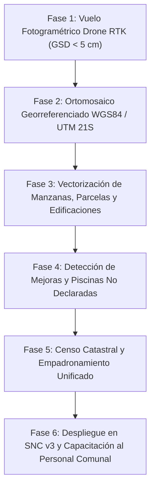

# PROPUESTA TÉCNICA E INSTITUCIONAL PARA GOBIERNOS MUNICIPALES
## MODERNIZACIÓN DEL CATASTRO MULTIFINALITARIO, ACTUALIZACIÓN CARTOGRÁFICA Y RECUPERACIÓN TRIBUTARIA MUNICIPAL

**Dirigido a:** Señores Intendentes Municipales, Miembros de la Honorable Junta Municipal, Directores de Catastro, Obras y Administración y Finanzas.  
**Plataforma Tecnológica:** Sistema Nacional Catastral Multifinalitario (SNC v3).  
**Marco Normativo:** Ley N.º 3966/2010 Orgánica Municipal, Ley N.º 125/1991, Ley N.º 5513/2015, Resolución SNC N.º 551/2023, Ley N.º 294/1993 y Ley N.º 4241/2010.

---

### RESUMEN EJECUTIVO (EL PROBLEMA Y LA OPORTUNIDAD)

La mayoría de los municipios del Paraguay enfrentan una asimetría crítica: **la ciudad real crece a un ritmo vertiginoso, pero el catastro municipal sigue estancado en planillas de papel o sistemas alfanuméricos ciegos**.

Esta desconexión genera pérdidas millonarias directas para las arcas comunales:
1. **Pérdida por Prescripción Quinquenal (Ley 125/91):** Las deudas por Impuesto Inmobiliario prescriben a los 5 años. Si el municipio no fiscaliza ni intima a tiempo de forma georreferenciada, la ley extingue el derecho de cobro de millones de guaraníes.
2. **Evasión por "Mejoras No Declaradas":** Cientos de inmuebles tributan como terreno baldío o edificación precaria, cuando en realidad poseen residencias modernas, tinglados comerciales, piscinas o complejos habitacionales.
3. **Loteamientos sin Cesión Legal (Art. 235 Ley 3966/10):** Se aprueban fraccionamientos sin control topográfico estricto, perdiendo el municipio las áreas públicas obligatorias (16% para calles y 5% a 7% para plazas y edificios públicos).
4. **Falta de Transparencia y Trámites Lentos:** Meses de demora para visar un plano o expedir un certificado catastral, generando descontento en el contribuyente y fuga de ingresos.

**Nuestra Propuesta:** Implementar un **Geoportal Municipal Multifinalitario en la nube (SNC v3)** junto con un **Programa Integral de Actualización Cartográfica de Alta Precisión**, autofinanciable en menos de 9 meses mediante el incremento natural de la recaudación tributaria.

---

## 1. LOS TRES PILARES DE LA SOLUCIÓN TECNOLÓGICA (SNC v3)

La plataforma SNC v3 no requiere comprar costosos servidores ni licencias privativas extranjeras; opera 100% en la nube y se adapta inmediatamente a la realidad de la comuna:

```
                                  SNC v3 MUNICIPAL
                 ┌───────────────────────┴───────────────────────┐
                 ▼                                               ▼
     MÓDULO DE GESTIÓN MUNICIPAL                        PORTAL CIUDADANO
     • Fiscalización tributaria (Semáforo)              • Consulta con Padrón o QR
     • Control de Loteamientos (Art. 235)               • Transparencia tributaria
     • Verificación ambiental (MADES)                   • Auto-gestión del contribuyente
     • Dictámenes Técnicos en 2 minutos                 • Sin filas en la municipalidad
```

### A. Geoportal Municipal Multifinalitario (`/municipal`)
- **TOC Estilo QGIS de Capas Comunales:** Gestión de barrios, vías, hidrografía, manzanas, parcelas y zonas de zonificación urbana y rural.
- **Cálculo Automático de Loteamientos (Art. 235 Ley 3966/10):** El sistema calcula automáticamente el balance exacto de cesiones: superficie útil de lotes, superficie vial (mínimo 16%) y superficie de plazas/edificios públicos (5% a 7%). Si el loteador no cumple, el sistema bloquea la visación.
- **Restricciones Ambientales Automatizadas (MADES / INFONA):** Detección inmediata si un inmueble invade la franja hídrica de 30 metros de arroyos (Ley 4241/10) o si se encuentra dentro del radio de amortiguamiento de 500 m / 1000 m de vertederos sanitarios.
- **Emisión de Dictámenes en 2 Minutos:** Generación automatizada de informes técnicos y dictámenes resolutivos en formato PDF oficial y DXF para agrimensores.

### B. Portal Ciudadano Pro (`/ciudadano`)
- El vecino puede consultar el estado de su inmueble desde su teléfono móvil ingresando su número de Padrón o escaneando un código QR impreso en su boleta de impuesto.
- Visualización de linderos, superficie, servicios básicos cercanos y constancia de visación municipal, reduciendo en un **70% la atención en ventanilla**.

### C. Fiscalización Tributaria y Prevención de Prescripción (Semáforo de Morosidad)
- **Círculo Verde:** Contribuyentes al día con el pago del Impuesto Inmobiliario y tasas de recolección/conservación de pavimento.
- **Círculo Naranja:** Morosidad media (1 a 3 años de atraso).
- **Círculo Rojo (Riesgo Crítico de Prescripción):** Cuentas con 4 a 5 años de mora. El sistema emite alertas tempranas y genera automáticamente las cédulas de notificación y liquidaciones prejudiciales para interrumpir la prescripción antes de que la deuda se extinga.

---

## 2. PLAN DE ACTUALIZACIÓN CARTOGRÁFICA DE ALTA PRECISIÓN

Para que el software funcione con la máxima eficacia, se lleva a cabo el relevamiento físico del territorio:



1. **Relevamiento Fotogramétrico Aéreo:** Vuelos con drones equipados con tecnología GNSS RTK/PPK de alta precisión centimétrica en el casco urbano y áreas de expansión.
2. **Detección Automática de Mejoras:** Superposición del mosaico aéreo sobre el catastro histórico para identificar qué parcelas figuran como baldíos pero poseen construcciones no declaradas.
3. **Empadronamiento Digital:** Asignación unívoca de Cuenta Corriente Catastral, Padrón y titularidad.
4. **Soberanía y Seguridad de Datos:** Los datos pertenecen 100% a la Municipalidad y quedan resguardados en bases de datos protegidas y respaldadas periódicamente.

---

## 3. IMPACTO FINANCIERO Y RETORNO DE LA INVERSIÓN (ROI)

El proyecto **no representa un gasto presupuestario a fondo perdido**, sino una inversión de altísimo retorno financiero autofinanciable:

| Concepto | Situación Actual (Sin SNC v3) | Con Catastro SNC v3 Actualizado | Impacto Económico para el Municipio |
| :--- | :---: | :---: | :---: |
| **Padrón Inmobiliario Activo** | 40% a 60% de predios reales | **95% a 100% de predios censados** | **+35% a +50%** de nuevos contribuyentes empadronados. |
| **Aforo de Edificación (Mejoras)** | Desactualizado (>10 años) | **Actualización al 100% de mejoras** | Duplica el valor imponible en predios subdeclarados. |
| **Pérdida por Prescripción (Ley 125/91)** | 15% a 25% de la cartera prescribe | **0% de pérdidas por prescripción** | Recupero masivo de deudas de 4to año vía notificaciones tempranas. |
| **Tiempo de Emisión de Dictámenes** | 15 a 45 días | **2 minutos en pantalla** | Máxima agilidad en aprobación de obras e inversiones. |
| **Recaudación Tributaria Anual** | Estancada | **Incremento del 40% al 120%** | **El proyecto se paga solo en 6 a 9 meses de recaudación.** |

---

## 4. CASO DE ÉXITO Y DEMOSTRACIÓN EN VIVO

El sistema cuenta con un municipio piloto plenamente operativo: **Piribebuy (Cordillera)**:
- Más de **11 capas temáticas integradas**: parcelario completo, red vial de 2.171 tramos, 34 barrios censales, hidrografía, casco histórico y zonas de restricción del vertedero municipal.
- Aprobación de fraccionamientos con validación topológica instantánea.
- El Intendente, los Concejales y los Directores pueden acceder hoy mismo a una demostración en vivo de la plataforma funcionando.

---

## 5. BENEFICIOS POLÍTICOS E INSTITUCIONALES PARA LA ADMINISTRACIÓN

1. **Legado de Modernización Histórico:** La administración que implementa el catastro digital deja un municipio ordenado para los próximos 25 años.
2. **Atracción de Inversiones Inmobiliarias:** Los desarrolladores, escribanos y bancos prefieren invertir en municipios con reglas claras, cartografía digital y trámites expeditos.
3. **Cero Conflictos de Límites:** Se terminan las disputas vecinales por solapamientos de planos o usurpación de calles públicas.
4. **Independencia y Soberanía Municipal:** El personal municipal recibe capacitación completa y opera el sistema de manera autónoma.

---

## 6. PRÓXIMOS PASOS RECOMENDADOS

1. **Reunión de Demostración Práctica:** Presentación interactiva de 30 minutos ante el Intendente y su equipo técnico (proyección en pantalla del visor municipal y casos reales).
2. **Diagnóstico Primario sin Costo:** Evaluación del estado del archivo catastral municipal y estimación preliminar de incremento en la recaudación.
3. **Firma de Convenio de Modernización:** Inicio del plan de vuelo fotogramétrico, digitalización y puesta en marcha del Geoportal Comunal.

---

*Desarrollado conforme a los estándares oficiales de la Dirección Nacional de Catastro (SNC) y la Federación Paraguaya de Municipios.*  
*Contacto Técnico y Coordinación Institucional disponibles para agendar sesión ejecutiva.*
